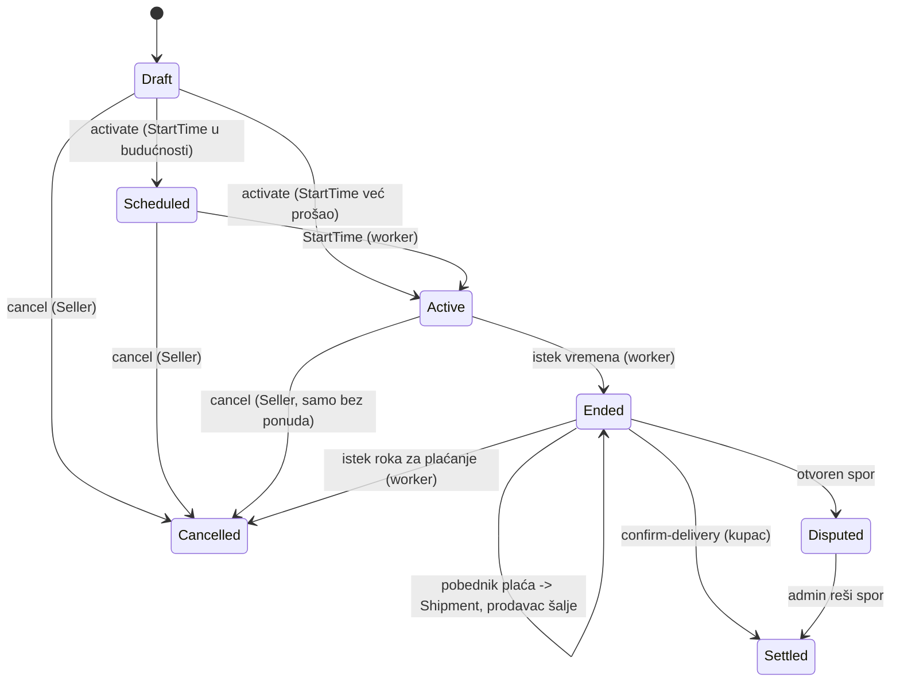
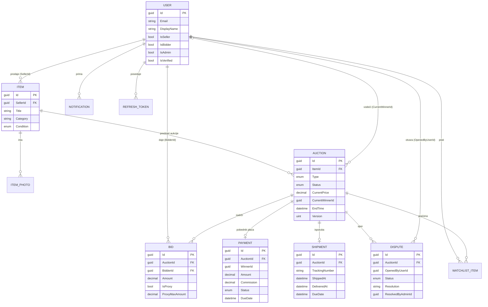

## Arhitektura

```
Domain  <-  Application (CQRS, validatori, interfejsi)  <-  Infrastructure (EF Core, repozitorijumi, JWT)  <-  Api (kontroleri, filteri, workeri)
```

- **AuctionPhaseMiddleware + `[AllowedPhases]`**: middleware iz rute izvlači `{id}`, učitava fazu aukcije (IMemoryCache, TTL 5 s, pa baza) i poredi je sa fazama deklarisanim atributom; pogrešna faza vraća 409 (Problem Details), nepostojeća aukcija 404, bez ulaska u kontroler/handler.
- **ExceptionHandlingMiddleware** (`Api/Middleware`): pravi ASP.NET Core middleware (`app.UseExceptionHandling()`); okružuje ostatak pipeline-a u try/catch i izuzetke mapira na RFC 7807 Problem Details (`application/problem+json`, uz `traceId`): 400/401/403/404/409; **503** za prolazne kvarove baze i timeout (EF ih umotava u `InvalidOperationException`, pa bi inače izgledali kao 409); **500** za sve ostalo (bez detalja klijentu); **499** kad klijent prekine zahtev. Ako je odgovor već počeo, izuzetak se propagira.
- **Redosled pipeline-a**: Serilog request logging → ExceptionHandlingMiddleware → HTTPS redirect → statički fajlovi (`/uploads`) → CORS → rate limiter → autentikacija → autorizacija → AuctionPhaseMiddleware → kontroleri.
- **PlaceBid**: transakcija sa `SELECT ... FOR UPDATE`, proxy bidding, anti-snipe produženje, Outbid obaveštenja.
- **AuctionClosingWorker** (30 s): zatvara istekle aukcije, pravi Payment (provizija 5%, rok 3 dana) i obaveštenje pobedniku.
- **PaymentOverdueWorker** (1 min): Pending → Overdue po isteku roka; aukcija prelazi u Cancelled, kupcu se povećava `CancelledAuctionsCount`, a prodavac dobija obaveštenje.
- **AuctionStartingWorker** (15 s): Scheduled → Active kada nastupi `StartTime`.
- **ShipmentOverdueWorker** (1 min): prodavac nije poslao u roku → aukcija Cancelled, Payment Refunded, prodavac dobija kazneni poen.
- **AuctionEndingSoonWorker** (1 min): obaveštenje `AuctionEndingSoon` pratiocima i lideru 60 min pre kraja.
- **Dutch aukcije**: cena pada za `BidIncrement` svakog minuta do donje granice (`ReservePrice`); prvi koji prihvati cenu pobeđuje.
- **Verifikacija**: nadmetanje zahteva verifikovan nalog + način plaćanja; pravljenje aukcije zahteva verifikovanog prodavca.
- **Rate limiting**: `/Auth/login` i `/Auth/register` (10 zahteva/min po IP).
- **Slike predmeta**: `IFileStorage` (lokalni disk, `FileStorage:RootPath` / `FileStorage:PublicPath`); u Dockeru je folder `/app/uploads` volume. Fajlovi se serviraju na `/uploads/...`.

## Osvežavanje podataka (polling)

Aplikacija ne koristi WebSocket/SignalR. Frontend periodično pita server:
- stranica aukcije osvežava detalje, istoriju ponuda i pitanja na svakih 4 s dok je aukcija `Active` (15 s za `Scheduled`); pauzira se dok je tab skriven;
- aplikacija proverava `GET /Notifications/mine` na svakih 15 s i novo nepročitano obaveštenje prikazuje kao toast.

Sva obaveštenja (Outbid, AuctionWon, QuestionAsked...) se čuvaju u tabeli `Notifications`, pa se ništa ne gubi ako korisnik nije na stranici.

## Životni ciklus aukcije



## ER dijagram



## API pregled (`/api/v1`)

| Grupa | Endpointi |
|---|---|
| Auth | `POST /Auth/register`, `/login`, `/refresh`, `/logout` |
| Items (Seller) | `POST /Items`, `GET /Items/mine`, `GET/PUT/DELETE /Items/{id}`, `POST /Items/{id}/photos` (multipart, polje `file`), `DELETE /Items/{id}/photos/{photoId}` |
| Auctions | `GET /Auctions`, `GET /Auctions/mine` (Seller), `GET /Auctions/{id}`, `POST /Auctions`, `/{id}/activate`, `/{id}/cancel`, `/{id}/bids` (POST/GET), `/{id}/ship`, `/{id}/confirm-delivery`, `/{id}/disputes` |
| Sporovi | `GET /Disputes/mine`, `POST /Disputes/{id}/photos` (multipart, polje `file`; JPEG/PNG/WebP do 5 MB, najviše 5 slika po sporu; samo korisnik koji je otvorio spor, dok nije rešen) |
| Users | `GET /Users/me`, `POST /Users/me/payment-method` |
| Ratings | `POST /Auctions/{id}/ratings` (Settled; `score` 1-5, `comment`), `GET /Users/{id}/rating` (javno: prosek, broj ocena, uspešne/otkazane aukcije, poslednje ocene) |
| Payments | `GET /Payments/mine`, `POST /Payments/{id}/pay` |
| Pitanja i odgovori | `GET/POST /Auctions/{id}/questions`, `POST /Auctions/{id}/questions/{questionId}/answer` (samo prodavac) |
| Shipments / Disputes / Notifications / Watchlist | `GET .../mine`, watchlist `POST/DELETE /{auctionId}`, notifikacije `POST /{id}/read` |
| Admin | `GET /Admin/disputes`, `POST /Admin/disputes/{id}/take`, `/resolve` (`outcome`: FavorSeller/RefundBuyer), `GET /Admin/users/unverified`, `POST /Admin/users/{id}/verify`, `GET /Admin/stats` |

## Frontend

Vidi `frontend/README.md` (React + Vite, `npm install && npm run dev`).
